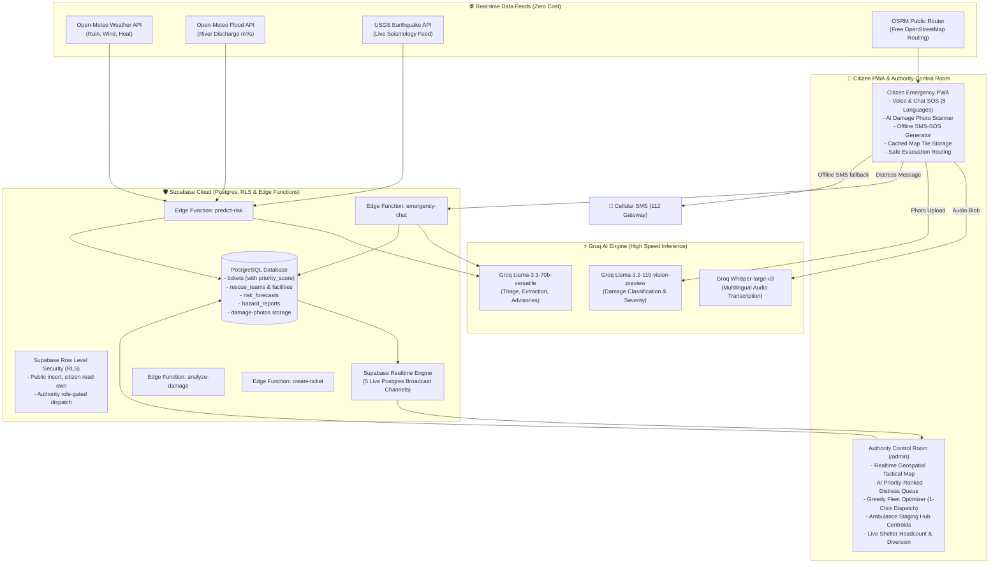

# 🇮🇳 JeevanSetu AI (जीवनसेतु)
### *AI-Powered Disaster Prediction, Multilingual Emergency Response & Rescue Coordination for India*
**Theme: "AI Living for India" | College Demo & Innovation Prototype**

[](#zero-cost-architecture)
[](#security-boundary)
[](#ai-models)
[](#un-sustainable-development-goals-sdgs)
[](#offline--low-network-engine)

---

## 🌟 Executive Summary

India experiences recurrent climate hazards — from urban flash flooding in Bengaluru and Mumbai to coastal cyclones in Odisha and landslides across the Western Ghats. Millions of citizens face language barriers during distress, while emergency dispatchers struggle with fragmented incoming data, blocked roadways, and uncoordinated relief logistics.

**JeevanSetu AI ("Bridge of Life")** is an end-to-end, zero-cost, real-time emergency ecosystem designed specifically for India. It bridges citizens in distress and disaster management authorities through:
1. **Predictive Risk Intelligence**: Proactive disaster warnings across Indian districts combining Open-Meteo weather and river discharge feeds with USGS seismology.
2. **Multilingual AI Triage**: Voice and text communication in 8 Indian languages (Telugu, Hindi, Tamil, Kannada, Bengali, Marathi, Malayalam, English) powered by Groq Llama-3.3 and Whisper.
3. **Hazard-Aware Safe Evacuation Routing**: Free OSRM turn-by-turn routing with dynamic avoidance of crowd-reported danger zones (submerged roads, downed high-voltage lines, fallen trees).
4. **Computer Vision Damage Assessment**: Groq Vision analysis (`llama-3.2-11b-vision-preview`) of geotagged disaster photos.
5. **Rescue Resource Optimizer**: Multi-factor priority scoring, greedy team-to-ticket matching, emergency cluster ambulance staging centroids, and shelter load balancing.
6. **Zero-Connectivity SMS-SOS Protocol**: Compact SMS fallback (`JSETU|<lat>,<lng>|...`) and pre-cached OpenStreetMap offline tiles.

---

## 🏗️ System Architecture



---

## ⚡ Core Capabilities (Phases 1 – 7)

### Phase 1: Disaster Prediction Engine
- **District Grid Forecasting**: Edge function `predict-risk` fetches live forecast parameters from Open-Meteo and river basin runoff discharge ($m^3/s$) combined with USGS earthquake feeds.
- **Rule-Based Risk Scoring**: Computes composite danger indices (0–100) for **Flood, Cyclone, Landslide, and Heatwave**.
- **AI Localized Advisory**: Groq Llama-3.3 generates plain-language, location-specific advisories and action-oriented preparedness checklists.
- **Citizen Risk Card**: Embedded on the home screen showing nearest district risk level and interactive safety checklists.

### Phase 2: Multilingual Emergency Assistant
- **8 Indian Languages Supported**: Telugu, Hindi, Tamil, Kannada, Bengali, Marathi, Malayalam, and English.
- **Natural Language Understanding**: Automatically detects language, extracts incident location, urgency level (1–5), people trapped, and vulnerability flags.
- **Speech In / Speech Out**: Voice recording transcribed via Groq Whisper (`whisper-large-v3`) with localized browser speech synthesis responses.
- **Auto Ticket Creation**: Direct handoff from conversational assistant to the emergency dispatch queue.

### Phase 3: Safe Routing & Hazard Avoidance
- **Zero-Cost Public OSRM Routing**: Generates driving and walking evacuation routes to the nearest designated shelter, hospital, or relief center without Google Maps API keys.
- **Crowd Hazard Danger Zones**: Active hazards (`flooded_road`, `power_cable`, `collapsed_bridge`, `fallen_tree`) are plotted as danger circles with custom avoidance radii (150m – 500m).
- **Dynamic Detour Engine**: Calculates polyline-to-hazard proximity; if a route intersects a danger zone, an automatic safe detour waypoint is calculated to bypass the obstacle.

### Phase 4: Crowd Damage Detection (Groq Vision)
- **Camera Capture & Upload**: Citizens upload or capture incident photos stored in Supabase Storage (`damage-photos`).
- **Structured Vision Inference**: Edge function `analyze-damage` sends image to Groq `llama-3.2-11b-vision-preview` returning:
  - Hazard Type (`flooded_road`, `power_cable`, `collapsed_bridge`, `fallen_tree`, `fire_smoke`, `blocked_path`)
  - Severity Rating ($1 - 5$)
  - Model Confidence Score ($0.0 - 1.0$)
  - Recommended Avoidance Radius in meters
- **Instant Broadcast**: Automatically creates an active `hazard_reports` record and pushes it via Realtime to authority tactical screens and citizen route maps.

### Phase 5: Rescue Resource Optimizer
- **Mathematical Priority Score Formulation**:
  $$\text{Priority Score} = (\text{Urgency} \times 20) + \text{Vulnerabilities Bonus} + \text{Waiting Bonus} + \text{Cluster Bonus}$$
  - *Urgency Base*: $20$ to $100$ pts.
  - *Vulnerability Weight*: $+15$ pts for elderly, disabled, medical; $+25$ pts for infants and pregnant women; $+5$ pts per victim (capped at $+25$).
  - *Waiting Time Accrual*: $+1.5$ pts per minute waiting (capped at $+60$ pts) preventing starvation of distress calls.
  - *Spatial Cluster Density*: $+10$ pts per neighboring ticket within $1.5\text{ km}$ (capped at $+40$ pts).
  - *Tiers*: **CRITICAL** ($\ge 110$), **HIGH** ($85-109$), **MEDIUM** ($55-84$), **LOW** ($<55$).
- **Greedy Fleet Matcher**: Pairs highest-priority victims to closest compatible specialized units (e.g. Floods $\to$ NDRF Boat; Maternal/Cardiac $\to$ 108 Ambulance; Structural $\to$ Fire Squad).
- **One-Click Batch Dispatch**: Authority officers can review candidates and click **"⚡ Accept All Matches"** to dispatch teams atomically.
- **Ambulance Staging Hubs**: Computes spatial cluster centroids $(\bar{\phi}, \bar{\lambda})$ within $2.0\text{ km}$ and recommends forward ambulance deployment numbers near referral hospitals.
- **Shelter Load Balancing**: Detects shelters $>85\%$ capacity and generates automated evacuee diversion recommendations to nearby underutilized shelters.

### Phase 6: Offline / Low-Network Engine
- **Compact SMS-SOS Protocol**: Formats emergency distress into an ultra-compact string under $80$ characters:
  $$\texttt{JSETU|<lat>,<lng>|<code>|<people>|<flags>|<msg30>}$$
  - *Example*: `JSETU|12.9716,77.5946|FL|4|INF,ELD|Water 4ft house trapped`
- **Native OS Intent**: One-tap pre-filled `sms:112?body=...` link triggers the phone's native messaging app without internet.
- **Map Tile Pre-Caching**: Service Worker v2 pre-downloads OpenStreetMap tiles ($5 \times 5$ grid at zoom levels 10–13) into CacheStorage.
- **IndexedDB Sync**: Queued offline reports automatically synchronize with the server upon network reconnection.

### Phase 7: Real-Time Authority Control Room
- **Live Postgres Subscriptions**: Realtime synchronization across 5 tables (`tickets`, `rescue_teams`, `facilities`, `risk_forecasts`, `hazard_reports`).
- **Realtime Incoming Distress Dropdown**: Instant high-visibility audio-visual banner when new SOS reports arrive with a "View & Locate" jump action.
- **Pan-India Crisis Watch Ticker**: Live disaster monitoring bar featuring Puri (Cyclone), Mangaluru (Flood), Karwar (Landslide), and Delhi NCR (Heatwave).
- **Live Fleet Management Board**: Control room operators can toggle unit availability (`Ready` $\leftrightarrow$ `On Mission`) in real time.
- **Shelter Evacuee Capacity Meter**: Visual aggregate gauge showing housed evacuees versus regional shelter capacity.

---

## 💰 Zero-Cost Architecture

Every tier of JeevanSetu AI runs entirely on perpetual free tiers:

| Component | Free Provider | Quota / Free Tier Limit | Production Purpose |
| :--- | :--- | :--- | :--- |
| **Frontend Hosting** | Vercel / Netlify | 100 GB bandwidth / month | React 18 PWA & Admin App |
| **Backend & DB** | Supabase Free Tier | 500 MB Postgres, 50,000 MAU | Database, Auth, Realtime, Storage |
| **Edge Compute** | Supabase Edge Functions | 500,000 invocations / month | Deno TypeScript Serverless |
| **LLM Inference** | Groq Cloud | Free developer tier | Llama-3.3-70b-versatile |
| **Vision AI** | Groq Cloud | Free developer tier | Llama-3.2-11b-vision-preview |
| **Speech-to-Text** | Groq Cloud | Free developer tier | Whisper-large-v3 |
| **Weather & Floods** | Open-Meteo API | 10,000 daily calls (Free for non-commercial) | Precipitation, River runoff, Wind |
| **Earthquakes** | USGS Seismology Feed | Free public government domain | Live seismic activity feed |
| **Map Tiles** | OpenStreetMap | Free public tiles | Street maps & disaster discs |
| **Safe Routing** | OSRM Public Demo Server | Free open-source routing | Polyline routing & detours |
| **Geocoding** | Nominatim (OSM) | 1 req/sec public rate limit | Reverse geocoding |

---

## 🎯 UN Sustainable Development Goals (SDGs)

```
┌─────────────────┬─────────────────┬─────────────────┬─────────────────┐
│     SDG 3       │     SDG 10      │     SDG 11      │     SDG 13      │
│  Good Health    │    Reduced      │   Sustainable   │     Climate     │
│  & Well-being   │  Inequalities   │     Cities      │     Action      │
└─────────────────┴─────────────────┴─────────────────┴─────────────────┘
```

1. **SDG 3: Good Health and Well-being (Target 3.d)**
   - *Target*: Strengthen early warning, risk reduction, and management of national and global health risks.
   - *JeevanSetu AI*: Rapid medical triage prioritizes maternal, pediatric, and cardiac emergencies; ambulance staging centroids optimize critical response times.

2. **SDG 10: Reduced Inequalities (Target 10.2)**
   - *Target*: Empower and promote social, economic, and political inclusion of all.
   - *JeevanSetu AI*: Eliminates the English language barrier by enabling non-literate and regional-language citizens to speak in their native tongue (Telugu, Hindi, Tamil, Kannada, etc.) to summon NDRF/SDRF help.

3. **SDG 11: Sustainable Cities and Communities (Target 11.5)**
   - *Target*: Significantly reduce deaths and the number of people affected by disasters.
   - *JeevanSetu AI*: Real-time crowd hazard mapping and safe evacuation routing direct vulnerable residents away from submerged roads, collapsed bridges, and live electrical hazards.

4. **SDG 13: Climate Action (Target 13.1)**
   - *Target*: Strengthen resilience and adaptive capacity to climate-related hazards and natural disasters.
   - *JeevanSetu AI*: District-level risk prediction engine synthesizes hydrological runoff and convective storm data into localized, actionable preparedness steps.

---

## 📱 Samsung Galaxy AI Alignment & Innovation Roadmap

Framed as an advanced hardware-software integration roadmap, JeevanSetu AI is architecturally positioned to leverage **Samsung Galaxy AI** and device ecosystems:

```
┌────────────────────────────────────────────────────────────────────────┐
│                   SAMSUNG GALAXY AI INTEGRATION ROADMAP                 │
├──────────────────────────────┬─────────────────────────────────────────┤
│ Galaxy Capability            │ JeevanSetu AI Implementation            │
├──────────────────────────────┼─────────────────────────────────────────┤
│ On-Device NPU                │ Zero-latency on-device multilingual     │
│ (Exynos / Snapdragon NPU)    │ transcription & translation for Indic   │
│                              │ dialects during complete tower blackout │
├──────────────────────────────┼─────────────────────────────────────────┤
│ Galaxy WearOS (Watch Ultra)  │ Fall detection, heart rate spike alert, │
│ Biometric Telemetry          │ and one-tap wrist SOS directly mapped   │
│                              │ to vulnerable flags (medical_condition) │
├──────────────────────────────┼─────────────────────────────────────────┤
│ Samsung SmartThings &        │ Automated emergency broadcast to home   │
│ Smart TV Emergency Hubs      │ appliances; siren alarms & flashlights  │
│                              │ triggered in flood-predicted zones      │
├──────────────────────────────┼─────────────────────────────────────────┤
│ Galaxy Wi-Fi Aware &         │ Peer-to-peer device mesh relaying       │
│ Device-to-Device Mesh        │ compact SOS packets across devices until│
│                              │ a node reaches cellular signal          │
└──────────────────────────────┴─────────────────────────────────────────┘
```

1. **On-Device Indic AI Inference (NPU Acceleration)**:
   - Run lightweight quantized models on-device using Samsung Galaxy AI NPU acceleration for instant voice translation without cloud connectivity.
2. **Wearable Emergency SOS (Galaxy Watch)**:
   - Integration with WearOS sensors to detect hypothermia, sudden submersion, or crush trauma, automatically injecting biometrics into the JeevanSetu priority scoring engine.
3. **Device-to-Device Relay Nodes (Disaster Mesh)**:
   - When cellular base stations collapse during cyclones, Samsung Galaxy devices act as low-energy Wi-Fi Aware relay hops, relaying compact `JSETU|...` SMS packets from handset to handset until reaching an NDRF command vehicle.

---

## 🎬 5-Minute Live Demo Script

Follow this script for an evaluation presentation:

| Time | Step | Screen / Action | What to Demonstrate |
| :---: | :--- | :--- | :--- |
| **0:00 - 1:00** | **1. Disaster Prediction & Preparedness** | Home Screen (`/`) | Point out the **Disaster Risk Card**. Change district or note Bengaluru/Mangaluru score. Show the AI advisory and check off items on the **Preparedness Checklist**. |
| **1:00 - 2:00** | **2. Multilingual Voice Triage** | `/assistant` or Mic button on `/` | Speak or type in Telugu/Hindi: *"ఇంట్లోకి 4 అడుగుల నీరు చేరింది. 2 చిన్న పిల్లలు డాబాపై చిక్కుకుపోయాము"* (Water 4ft deep, 2 infants trapped). Show language auto-detection, translation, and automated emergency ticket creation. |
| **2:00 - 2:45** | **3. AI Vision Damage Scan** | Home Screen (`/`) $\to$ **Scan Damage** | Open **AI Damage Scanner**, pick/capture a flood photo. Tap **Analyze with Groq Vision**. Observe instant categorization: `flooded_road`, Severity: `4/5`, Avoid Radius: `350m`. Broadcast hazard to community. |
| **2:45 - 3:30** | **4. Safe Evacuation Routing** | `/safety-guidance` | Select nearest shelter (*Kanteerava Stadium*). View the interactive map. Point out the red danger circle around the flooded road and the green safe route that automatically detours around it. |
| **3:30 - 4:15** | **5. Authority Optimizer & Dispatch** | Authority Screen (`/admin`) | Log in (`authority@jeevansetu.gov.in` / `Password@123`). Show the **Ranked Queue** where the Telugu ticket with infants has floated to **CRITICAL (⚡ 200 PTS)**. Open **AI Resource Optimizer** and demonstrate **⚡ Accept All Matches (One-Click Dispatch)**. |
| **4:15 - 5:00** | **6. Offline Fallback & Staging Hubs** | `/` (Offline Panel) & `/admin` | Show **Ambulance Staging Hub** centroids on the map. Toggle Network to Offline in DevTools; show the **SMS-SOS link generator** with compact payload (`JSETU|...`) and map tile caching. |

---

## 🚀 Quick Start & Setup Guide

### Prerequisites
- Node.js v18+ and npm
- Supabase CLI (optional for cloud, required for local edge functions)
- A free [Groq Cloud API Key](https://console.groq.com/)

### 1. Clone & Install Dependencies
```bash
git clone https://github.com/2326praveen/JeevanSetu.git
cd JeevanSetu/frontend
npm install
```

### 2. Configure Environment Variables
Copy `.env.example` to `.env` inside `frontend/`:
```bash
cp .env.example .env
```
Fill in your Supabase project credentials:
```env
VITE_SUPABASE_URL=https://your-project-ref.supabase.co
VITE_SUPABASE_ANON_KEY=your-supabase-anon-key
```

### 3. Apply Supabase Database Migrations
Run the migrations in order in your Supabase SQL Editor:
1. `supabase/migrations/20260925000000_initial_schema.sql` (Tables & RLS)
2. `supabase/migrations/20261029000000_authority_dashboard.sql` (Teams & Nearest RPC)
3. `supabase/migrations/20261030000000_risk_forecasts.sql` (Risk engine & Realtime)
4. `supabase/migrations/20261030000001_chat_assistant.sql` (Conversational triage)
5. `supabase/migrations/20261031000000_safe_routing.sql` (Hazard reports & OSRM)
6. `supabase/migrations/20261031000001_damage_detection.sql` (Storage bucket & Vision)
7. `supabase/migrations/20261031000002_resource_optimizer.sql` (Priority score & Batch dispatch)
8. `supabase/migrations/20261101000000_dashboard_polish.sql` (Facilities Realtime & Fleet RPC)
9. *(Optional)* Run `supabase/seed.sql` to seed Karnataka facilities and shelters.

### 4. Deploy Supabase Edge Functions
Configure your Groq API key in Supabase Secrets:
```bash
supabase secrets set GROQ_API_KEY="your-groq-api-key"
```
Deploy the edge functions:
```bash
supabase functions deploy predict-risk --no-verify-jwt
supabase functions deploy emergency-chat --no-verify-jwt
supabase functions deploy analyze-damage --no-verify-jwt
supabase functions deploy create-ticket --no-verify-jwt
```

### 5. Run the Local Development Server
```bash
cd frontend
npm run dev
```
Open [http://localhost:5173](http://localhost:5173) in your browser.

---

## 🧪 Automated Test Suite

Run the individual phase test suites from the root folder:

```bash
# Phase 1: Disaster Prediction Engine (Open-Meteo & USGS feeds)
node scripts/test_predict_risk.mjs

# Phase 2: Multilingual Assistant (8 Indic languages auto-detection)
node scripts/test_multilingual_assistant.mjs

# Phase 3: Safe Routing & Hazard Avoidance (OSRM detours)
node scripts/test_safe_routing.mjs

# Phase 4: Crowd Damage Detection (Groq Vision schema validation)
node scripts/test_damage_analysis.mjs

# Phase 5: Rescue Resource Optimizer (Priority formula & Greedy dispatch)
node scripts/test_rescue_optimizer.mjs

# Phase 6: Offline Engine (SMS-SOS compact encoding & decoding)
node scripts/test_offline.mjs

# Phase 7: Dashboard Polish (Realtime mutations & summary metrics)
node scripts/test_dashboard_polish.mjs
```

---

## 🔐 Credentials for Demo Evaluation

- **Authority Control Room URL**: `/admin`
- **Email**: `authority@jeevansetu.gov.in`
- **Password**: `Password@123`
*(A built-in demo authentication fallback is included so evaluators can test the complete control room even if local Supabase Auth containers are disconnected).*

---

## 📜 License

Built for open-source disaster resilience and educational demonstration. Distributed under the MIT License.
EOF
